# Architecture

How Windtunnel is put together, from the whole system down to the agents.
Every diagram names the files that hold what it shows. The in-app view of
this page is under the book icon in the top bar (`/app/docs`).

**Keep this file current.** A change that adds, removes or renames a stage,
an agent, a table, an API route group, a connector or a top-level module
updates the matching section here in the same commit. `pnpm test` checks
that every file path, stage, agent and table named below still exists.

## 1. The system

One Next.js server holds the site, the product app, the API and the engine.
A run is not a separate service: it runs inside the server process and
outlives the request that started it.

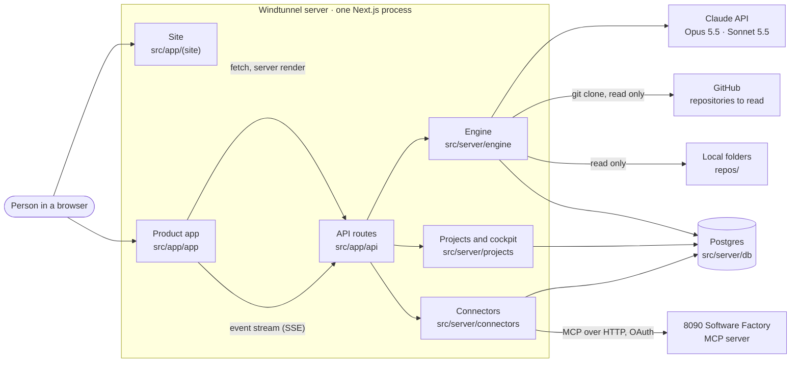

| Part                  | Where                              | What it does                                       |
| --------------------- | ---------------------------------- | -------------------------------------------------- |
| Site                  | `src/app/(site)/page.tsx`          | The home page                                      |
| Product app           | `src/app/app/layout.tsx`           | Projects, cockpit, runs, settings                  |
| API                   | `src/app/api/`                     | `runs`, `projects`, `connectors`, `demo`, `health` |
| Engine                | `src/server/engine/run.ts`         | The stages of a run                                |
| One door to the model | `src/server/engine/llm.ts`         | Every Claude API call                              |
| Run registry          | `src/server/engine/registry.ts`    | Starts runs, streams their events                  |
| Database              | `src/server/db/schema.ts`          | The tables; migrations in `drizzle/`               |
| Docker                | `docker-compose.yml`, `Dockerfile` | The app and Postgres, locally                      |

## 2. The code, module by module

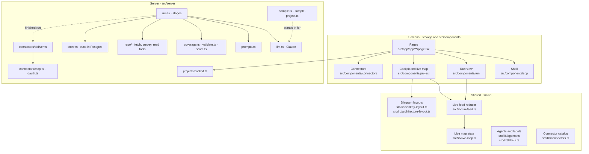

Rules that hold across modules (from `CLAUDE.md`):

- Only `src/server/engine/llm.ts` talks to the Claude API.
- Only `src/server/connectors/mcp.ts` talks to an MCP server.
- Nothing from a repository is ever installed, built or run.
- A model's claims are checked by code before they are kept.

## 3. A run, stage by stage

```mermaid
flowchart LR
  start(["Run started<br/>registry.ts startRun"]) --> survey
  survey["survey<br/>fetch, list files,<br/>data inventory<br/>repository runs only"] --> model
  model["model<br/>Opus 5.5<br/>design model, then<br/>architecture (2nd call)"] --> coverage
  coverage["coverage<br/>no model call<br/>gaps code can see"] --> agents
  agents["agents<br/>Sonnet 5.5 × 5<br/>in parallel"] --> challenge
  challenge["challenge<br/>Sonnet 5.5 × 5<br/>review each other"] --> judge
  judge["judge<br/>Opus 5.5<br/>merge, reject, rank<br/>+ secrets found by code"] --> chains
  chains["chains<br/>Opus 5.5<br/>issues that add up to a breach<br/>code runs only"] --> remediation
  remediation["remediation<br/>Opus 5.5<br/>fix, patch, CWE, OWASP<br/>security findings only"] --> work_orders
  work_orders["work_orders<br/>Opus 5.5<br/>with acceptance criteria"] --> done
  done(["Run completed"]) -. "project linked" .-> deliver["Send work orders<br/>connectors/deliver.ts"]
```

| Stage       | Code                                                                                                         | Model      | Checked by                                                                                                               |
| ----------- | ------------------------------------------------------------------------------------------------------------ | ---------- | ------------------------------------------------------------------------------------------------------------------------ |
| survey      | `src/server/engine/repo/fetch.ts`, `src/server/engine/repo/survey.ts`, `src/server/engine/repo/inventory.ts` | none       | file and size limits                                                                                                     |
| model       | `src/server/engine/run.ts` with `MODEL_SYSTEM` or `REPO_MODEL_SYSTEM` in `src/server/engine/prompts.ts`      | Opus 5.5   | `normalizeModel` in `src/server/engine/coverage.ts`, `normalizeArchitecture` in `src/server/engine/architecture.ts`      |
| coverage    | `findCoverage` in `src/server/engine/coverage.ts`                                                            | none       | it is code                                                                                                               |
| agents      | `src/server/engine/run.ts`, briefs in `src/lib/agents.ts`                                                    | Sonnet 5.5 | `checkAgentReport` in `src/server/engine/validate.ts`, or `report_finding` in `src/server/engine/repo/agent-tools.ts`    |
| challenge   | `CHALLENGE_SYSTEM` in `src/server/engine/prompts.ts`                                                         | Sonnet 5.5 | `checkChallenges` in `src/server/engine/validate.ts`                                                                     |
| judge       | `JUDGE_SYSTEM` in `src/server/engine/prompts.ts`                                                             | Opus 5.5   | `reconcileVerdict` in `src/server/engine/validate.ts`                                                                    |
| chains      | `chainsStage` and `CHAINS_SYSTEM` in `src/server/engine/kinds/chains.ts`                                     | Opus 5.5   | `checkChains` (every link an accepted issue, every cited step's lines exist, never below its worst link)                 |
| remediation | `src/server/engine/remediation.ts`, `REMEDIATION_SYSTEM` in `src/server/engine/prompts.ts`                   | Opus 5.5   | `checkEdits` (every edit matches the real file), `resolveCwe` and `resolveOwasp` in `src/server/engine/security-refs.ts` |
| work_orders | `WORK_ORDER_SYSTEM` in `src/server/engine/prompts.ts`                                                        | Opus 5.5   | `checkWorkOrders` in `src/server/engine/validate.ts`                                                                     |

The stage list is `STAGES` in `src/server/engine/schema.ts`. Models are set
with `WINDTUNNEL_MODEL_REASONING` and `WINDTUNNEL_MODEL_AGENTS`
(`src/server/engine/config.ts`).

## 4. The agents

Five agents, each with one brief and its own expertise, compete to find
flaws. A judge credits each for the real flaws it found, more when no other
agent found them.

| Agent            | id                 | Looks for                                                    | Expertise                                         |
| ---------------- | ------------------ | ------------------------------------------------------------ | ------------------------------------------------- |
| Everyday user    | `normal_user`      | Everyday journeys that the design leaves undefined           | `src/server/engine/expertise/normal-user.md`      |
| Attacker         | `adversarial_user` | Abuse: permissions, tenancy, injection, secrets              | `src/server/engine/expertise/adversarial-user.md` |
| Outage tester    | `chaos`            | Failure part-way: retries, timeouts, ordering, lost messages | `src/server/engine/expertise/chaos.md`            |
| Load tester      | `scale`            | Growth: unbounded lists, hot paths, limits, cost             | `src/server/engine/expertise/scale.md`            |
| Product reviewer | `product_critic`   | What the product must decide but has not                     | `src/server/engine/expertise/product-critic.md`   |

The briefs are `AGENTS` in `src/lib/agents.ts`; the expertise notes are
loaded by `src/server/engine/expertise.ts`.

### How they run

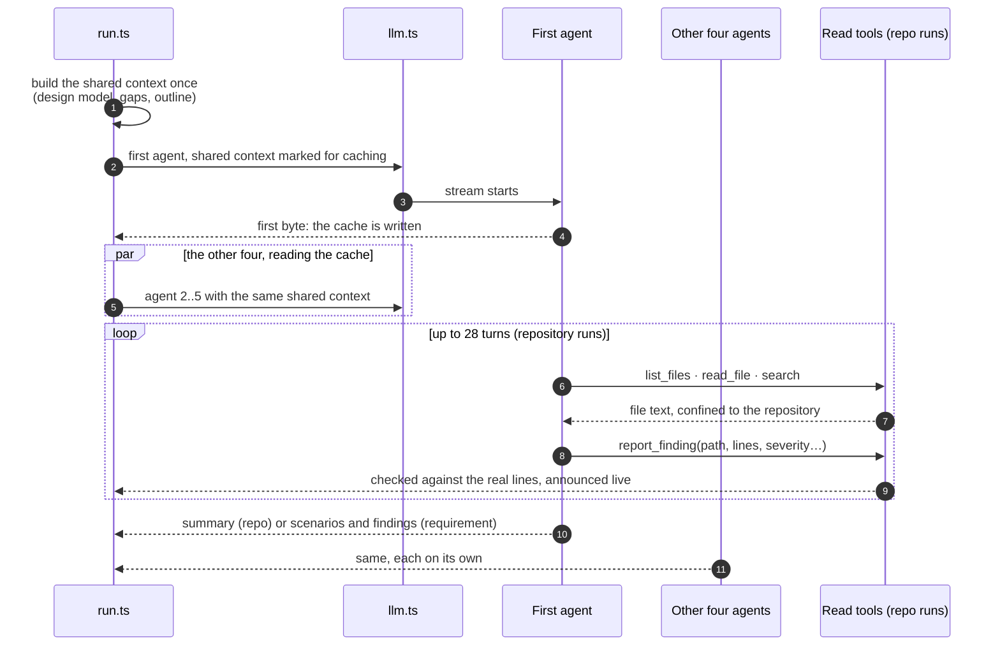

Why the first agent starts alone: the five share one long context. Sending
it once and letting it be cached before the others start makes the other
four read it at a fraction of the price (`release` in
`src/server/engine/run.ts`).

### Two kinds of run

|               | Requirement run                                            | Repository or project run                                                                  |
| ------------- | ---------------------------------------------------------- | ------------------------------------------------------------------------------------------ |
| Input         | A written requirement and files                            | One or more repositories (workspaces)                                                      |
| Agent call    | One structured answer: scenarios and findings (`llm.call`) | A tool loop (`llm.agent`): read the code, file findings one by one                         |
| Tools         | none                                                       | `src/server/engine/repo/agent-tools.ts`, reading through `src/server/engine/repo/tools.ts` |
| Finding check | Every reference must exist in the design model             | Every cited file and line must exist in the code                                           |
| Live findings | At the end                                                 | The moment each is filed                                                                   |

### From findings to work orders

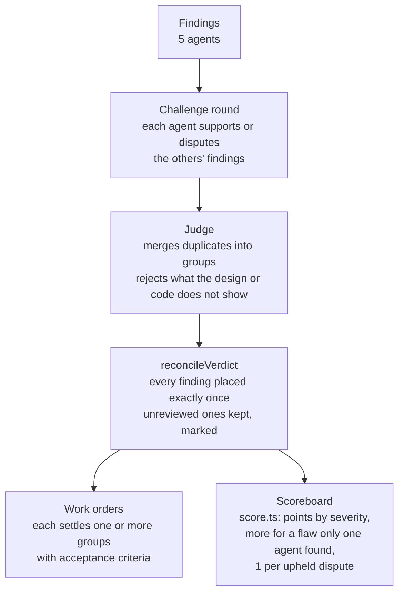

### The stand-in model

`ScriptedLlm` in `src/server/engine/sample.ts` takes the place of `llm.ts`
for tests, sample mode and sample projects. It makes the same tool calls a
model would, so every check still runs. The Storefront script is
`src/server/engine/sample-project.ts`, keyed by repository, against the
files in `samples/storefront/`.

## 5. Security: remediation, personal data and secrets

Three parts work together. None of them runs code from the repository.

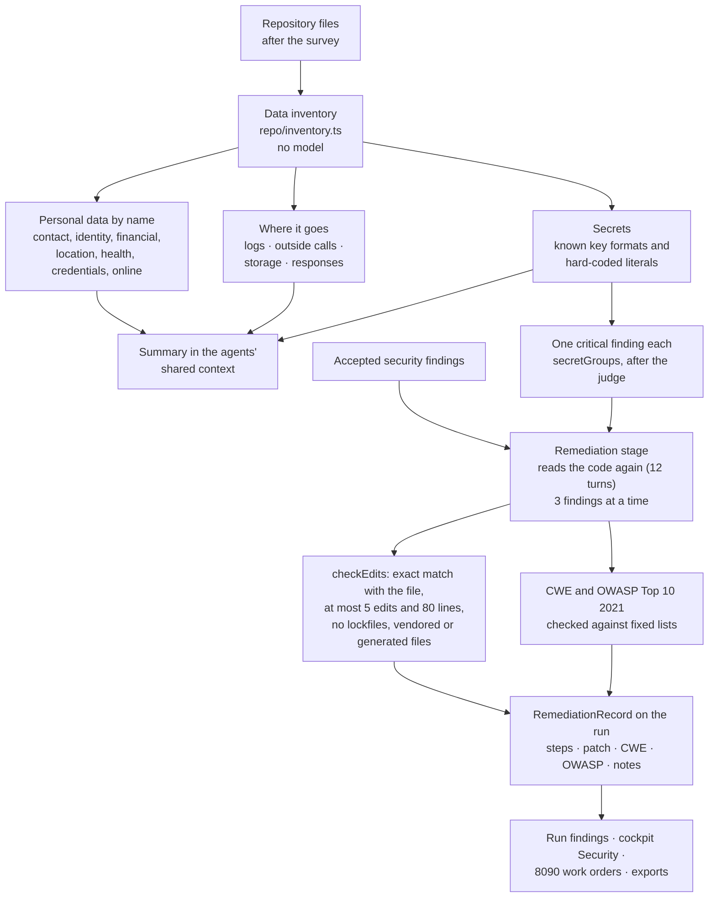

| Part            | Where                                                                                                             | Holds to                                                                                                                       |
| --------------- | ----------------------------------------------------------------------------------------------------------------- | ------------------------------------------------------------------------------------------------------------------------------ |
| Data inventory  | `src/server/engine/repo/inventory.ts`                                                                             | Found by name, so it may include false positives; says so on screen                                                            |
| Secret findings | `secretGroups` in `src/server/engine/remediation.ts`                                                              | A secret's value is never saved: only its kind, file, line and a masked line. `scrubDeep` masks it in everything the run saves |
| Remediation     | `src/server/engine/remediation.ts`                                                                                | Never fails the run; an edit that does not match the file is dropped with the reason; a patch is never applied                 |
| References      | `src/server/engine/security-refs.ts`                                                                              | An unknown CWE falls back to its OWASP category's CWE, marked as such                                                          |
| Diff            | `src/lib/patch.ts`                                                                                                | Three lines of context; `git apply --check` accepts it                                                                         |
| Screens         | `src/components/run/remediation.tsx`, `src/components/project/security.tsx`, `src/components/project/privacy.tsx` | Colour only in the diff                                                                                                        |

Not covered yet: known-vulnerable dependencies (needs an advisory database).

## 6. Live updates

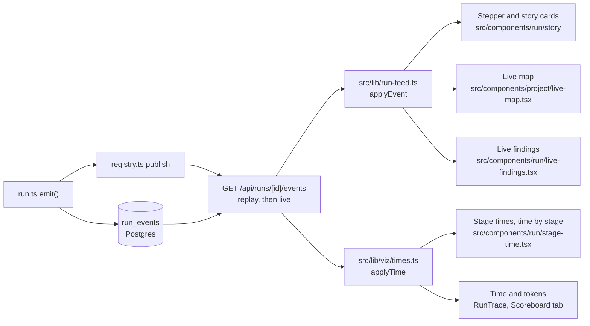

`applyTime` keeps when each stage and agent started and ended, from the
events' own times. `storyOf` (`src/lib/viz/story.ts`) turns the feed and the
saved run into one chapter per stage: a card appears when its stage starts
and turns into what the stage found when it finishes; a finished run shows
a summary, with the story folded under "How the run went". `applyTime` also
keeps when each scenario and finding arrived, which draws the agents'
parallel lanes. A finished run's Issues tab is built from `issueRows`
(`src/lib/viz/insights.ts`) and its right column from
`src/lib/viz/run-widgets.ts`; the run page loader adds the project's
previous run and the 8090 deliveries. The bar under the stage rail and the flame graph in the
Scoreboard tab are drawn from it; nothing is timed that has no event.

Every event is saved before it is sent, so a page opened half-way replays
what it missed. The event types are `RunEvent` in
`src/server/engine/schema.ts`; the stream is
`src/app/api/runs/[id]/events/route.ts`.

## 7. Projects and the cockpit

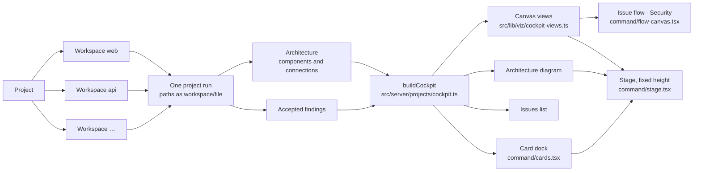

The cockpit is a command center on one stage of fixed height
(`src/components/project/command/stage.tsx`): a switcher picks the view
(issue flow, architecture, security; `?view=` in the address),
and the bar, filters, legend and card dock float on top. Each flow view is a
pure adapter in `src/lib/viz/cockpit-views.ts` that turns the cockpit into
sources, hubs, groups, coloured bands, a note and a legend;
`src/lib/viz/stage-layout.ts` fits it to the stage's box (even slots, rings
sized to the room, every node shown: a crowded column puts its names beside
the rings), and
`src/components/project/command/flow-canvas.tsx` draws it. The four cards
(`src/components/project/command/cards.tsx`) read the change and trend from
the project's earlier finished runs and the 8090 deliveries of this run.
Focus mode (`?focus=1`) draws the stage over the whole screen through a
portal, adds the widget column (`src/components/project/command/rail.tsx`)
and opens details in a drawer (`src/components/project/command/drawer.tsx`).
The words behind every "i" tooltip are in `src/lib/explain.ts`. The widgets
come from `src/components/tuff/` (from tuffui.com, MIT).

### The fix loop

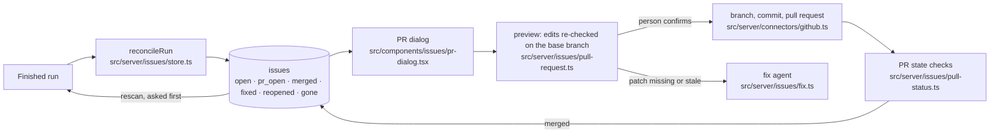

Matching (`src/server/issues/match.ts`) pairs a run's issue with a tracked
one by kind and cited file, then CWE, then title words; reconciling
(`src/server/issues/reconcile.ts`) decides each state change. An issue's
`origin` is the kind of run that found it (`code` or `requirement`), and a
run only reconciles issues of its own origin. The Projects page
(`src/app/app/projects/page.tsx`) reads its numbers from
`src/lib/viz/home.ts`: per project its share fixed, open issues by severity
and next action.

## Requirement versions

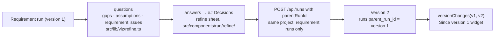

`threadOf` numbers a requirement's versions from the project's runs, oldest
first. Building questions and comparing versions read finished runs only;
no step calls the model until the next version runs.

Projects and workspaces: `src/server/projects/store.ts`. Older runs with no
project are gathered under "Demo project" by `src/server/projects/adopt.ts`.
Sample data: `src/server/projects/demo.ts`. A run saved before a fix is
mended as the store reads it (`repairRun` in `src/server/engine/repair.ts`):
an Engine Out run whose hops share an id gets one id per hop, and each
finding takes its hop's new id. What is saved is left as it was.

A requirement run's results are probable risks of an idea. One switch,
`termsFor(probable)` in `src/lib/labels.ts`, gives the words everywhere
(run page, story, cockpit, lists, exports, 8090 work orders), and tracked
requirement issues (`issues.origin = "requirement"`) are reconciled only
against earlier versions of the same requirement.

## Run kinds

A run has a kind (`runs.kind`; absent on old runs, which are audits). Each
kind has its own stages (`STAGES_OF` in `src/server/engine/schema.ts`);
`executeRun` in `src/server/engine/run.ts` skips the stages a kind does not
have and hands the rest to an executor in `src/server/engine/kinds/`. Only
audits update tracked issues and send work orders to 8090.

| Kind       | Stages                                                                              | Executor                               |
| ---------- | ----------------------------------------------------------------------------------- | -------------------------------------- |
| Audit      | survey, model, coverage, agents, challenge, judge, chains, remediation, work_orders | `src/server/engine/run.ts`             |
| Crosswind  | change, survey, model, coverage, agents, challenge, judge, impact, work_orders      | `src/server/engine/kinds/crosswind.ts` |
| Fly-off    | model, proposals, critique, judge                                                   | `src/server/engine/kinds/flyoff.ts`    |
| Black box  | survey, triage, remediation                                                         | `src/server/engine/kinds/blackbox.ts`  |
| Engine Out | survey, map, cut, cascade                                                           | `src/server/engine/kinds/engineout.ts` |
| Dogfight   | survey, duel, verdict                                                               | `src/server/engine/kinds/dogfight.ts`  |
| Preflight  | survey, split, trace                                                                | `src/server/engine/kinds/preflight.ts` |

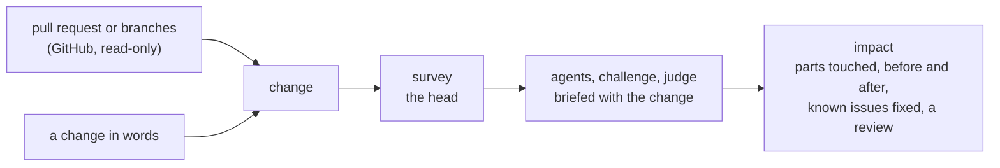

**Crosswind** reads the change (`pullRequest`, `pullFiles`, `compare` in
`src/server/connectors/github.ts`; a pull request from a fork is refused),
points the survey at its head, and runs the audit's agents with the change
in their shared context (`changeContext` in
`src/server/engine/kinds/prompts.ts`): they file what it breaks, citing the
head. The impact stage works out in code which parts it touches and how the
architecture differs from the last audit (`src/server/engine/kinds/impact.ts`;
for a change in words the model draws the after picture), then asks the
model for a summary, a pull request review and which known issues it fixes.

**Fly-off** has three designers (`PROPOSERS`: Pragmatist, Scaler, Guardian)
each write a blueprint for a requirement, critique the others, and a judge
rank them and pick one (`checkCritiques` and `checkVerdict` hold them to real
blueprints).

**Black box** takes production feedback (`runs.data.incident`). The triage
agent reads the code and names the lines behind it; `checkSuspects` keeps
only lines that exist, the defect becomes one finding, and the remediation
stage writes a fix for it whatever its kind (`anyKind`). The defect is
tracked as a code issue (`trackIncident` in `src/server/issues/store.ts`;
an open issue at the same place is reused), so its fix opens a pull request
through the same flow as any issue.

**Engine Out** cuts one part of the application on purpose, down or slow
(`runs.data.outage`). The map stage takes the map of the project's latest
code run of the same workspaces, or draws one (`ARCHITECTURE_SYSTEM`), and
finds the part by id or name (`findPart`). In the cut stage the Outage
tester and the Everyday user read the code of everything that calls it and
file each step of the failure through `report_hop` (`reportHopTool`): the
part whose code is cited, the part the failure comes from, what the code
does, and lines that are checked when filed. The cascade stage has the
judge order the hops by distance from the cut and say what each journey
comes to (`orderCascade` keeps every filed hop; a hop that holds is never
above low). Hops that need fixing become findings (`outageGroups`). Nothing
is run, and project issues are not changed by a what-if run.

**Dogfight** puts the fix of a security issue to an attacker
(`runs.data.dogfight`). In the duel stage the defender brings the fix the
earlier run wrote, or writes one; the attacker (Sonnet, the Attacker's
notes) reads the code with the fix applied in memory
(`RepoReader.withOverlay`) and either cites lines of the fixed code that
show a way through (`checkAttack`) or says it holds. The defender answers
on top of its own fix, for at most three rounds. `combinedEdits` turns the
rounds into one checked fix against the original files. A fix that held is
written back onto the run its issue came from (`hardenIssueFix` in
`src/server/engine/registry.ts`), so the issue's pull request is the
hardened one and says how many rounds it held. A Black Box run puts its fix
through the same duel, for at most two rounds.

**Preflight** checks a written spec against the code (`runs.data.preflight`).
The split stage is code: `splitSpec` takes the spec's list items and
sentences, in its own words, and `lensOf` gives each line to the agent
whose lens fits it. In the trace stage the five agents, in parallel, read
the code for their lines and report each through `report_line`
(`reportLineTool`): implemented, partly or contradicted with the code that
shows it (each range checked; a claim with none left is refused), or
missing with where they searched. A line no agent reported stays "not
checked". The result exports as a traceability table in Markdown and CSV
(`src/lib/viz/preflight.ts`).

Every kind has a free scripted path: `src/server/engine/sample-kinds.ts`
holds sample answers, and `ScriptedLlm` tells the kinds apart by the answer
format they ask for.

**Cost.** `src/lib/cost.ts` prices a run's usage per stage on its model
(cache writes at 1.25 times input) and the run stores it at the end
(`runs.cost_usd`). Each finished run also stores its issue counts by
severity (`runs.counts`), for trends.

**Idea to code.** A code run can name the requirement run it builds
(`runs.requirement_run_id`). After it, `linkAcross` in
`src/server/issues/match.ts` matches each risk of the idea to a code issue
(stemmed title words, at least two shared, measured against the shorter
title) and records it in `issues.realized_by_issue_id`.

**Schedules.** A project can run an audit daily or weekly at an hour, with
a monthly cap in dollars (`projects.schedule`, `schedule_hour`,
`monthly_cap_usd`, `next_run_at`, `schedule_note`). `src/instrumentation.ts`
starts the loop in `src/server/schedule/scheduler.ts`: each tick claims due
projects with an optimistic update on `next_run_at`, so two servers never
start the same run, and skips a run (with a note on the project) when this
month's spending plus the last audit's cost would pass the cap. The times
are worked out in `src/server/schedule/plan.ts`; the dialog that sets them
says that a schedule is the owner's standing permission for those runs.

**Screens.** The home page (`src/app/app/page.tsx`,
`src/components/home/launcher.tsx`) is a launcher: one card per kind of run,
from `src/lib/features.ts`, which names each kind, its question, its input,
its result and its workers. A card opens the one start page
(`src/app/app/runs/new/page.tsx`, `src/components/run/start/start-form.tsx`);
what it sends to `POST /api/runs` for each kind, and what is missing first,
is `src/lib/start-run.ts`. Every page sits in the side navigation
(`src/components/app/app-sidebar.tsx`), which lists the runs in progress
and the projects from `src/lib/viz/sidebar.ts`, read in
`src/app/app/layout.tsx` and kept current from `GET /api/runs`. A run page
is one header panel (`src/components/run/run-header.tsx`) and three
sections: **Live** or **Result**, **Details** (the other tabs, `?tab=`) and
**Activity**. The live view is the wind tunnel, in 3D
(`src/components/run/crew/tunnel-3d/`: three.js, loaded only on the run
page, with the 2D `WindTunnelFlat` where WebGL cannot draw). While the run
goes on the page holds little else: a one-line header (`RunHeader
minimal`), the newest finding (`LatestFinding`) and one progress line
(`StageProgress`); when it ends the tabs return and the stages show as a
rail (`Stepper variant="rail"`).
Where its parts stand is `TUNNEL_3D` in `src/lib/viz/tunnel.ts`: the
camera, each worker's stream, each part's tile, and `project`, the
camera's projection, which places the names over the drawing. What it
shows comes from `crewOf` in `src/lib/viz/crew.ts` (the five agents from
`agent.*` events, or a newer kind's workers from `actor.*` events,
`src/server/engine/kinds/`) and from `tunnelScene` in
`src/lib/viz/tunnel-scene.ts`: the application's parts on three plates,
and what the run's kind adds (findings as pins, chains, a ripple, three
designs, a failing route, a cut and its hops, duel rounds, the spec's
lines). Engine Out's hops and Preflight's lines are saved mid-stage and
announced with a `run.progress` event, so the page fetches the run again
(at most once every 750ms) and the tunnel shows them as they come. `blackbox.ts`). The result card is `resultOf` in `src/lib/viz/result.ts`; a project page is the same pattern, its tabs (`?tab=`) rendered
on the server, with `Cockpit`'s `section` prop choosing the stage, the
issues or security. The project page's kind buttons open the start page;
`src/components/project/kind-dialogs.tsx` holds the schedule dialog. The
run page shows each kind's report from
`src/components/run/kinds/kind-report.tsx`, and a Crosswind run marks the
parts it touches on the architecture diagram. Under the cockpit,
`src/components/project/issue-trend.tsx` draws open issues by severity over
the project's finished audits (`trendRuns` in `src/lib/viz/trend.ts`), from
`runs.counts`; for older runs without counts the page reads the run once.

## 8. The data

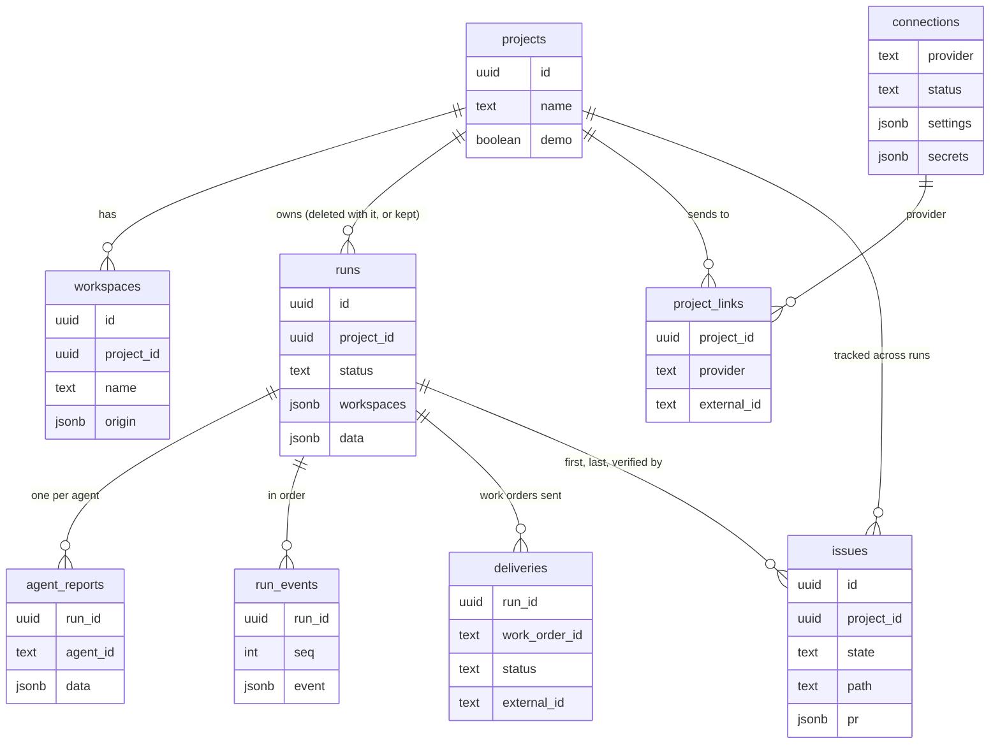

Tables: `projects`, `workspaces`, `runs`, `agent_reports`, `run_events`,
`connections`, `project_links`, `deliveries`, `issues`. The structured results of a
run are JSON in `runs.data`, shaped by `RunRecord` in
`src/server/engine/schema.ts`. Migrations are applied at start by
`src/server/db/ready.ts`.

## 9. Connectors

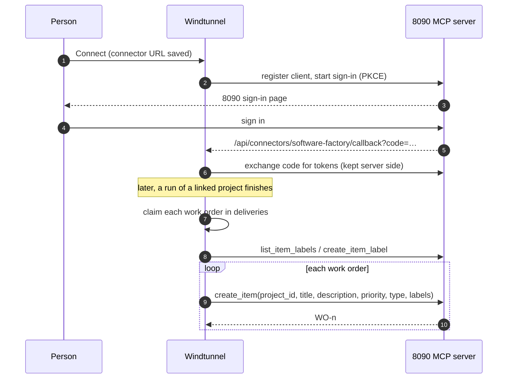

| Part                      | Where                                                                                                                                |
| ------------------------- | ------------------------------------------------------------------------------------------------------------------------------------ |
| MCP client                | `src/server/connectors/mcp.ts`                                                                                                       |
| Sign-in and token storage | `src/server/connectors/oauth.ts`, `src/server/connectors/store.ts`                                                                   |
| 8090 mapping              | `src/server/connectors/software-factory.ts`                                                                                          |
| Sending, once each        | `src/server/connectors/deliver.ts`                                                                                                   |
| Screens                   | `src/components/connectors/connectors.tsx`, `src/components/connectors/project-link.tsx`, `src/components/connectors/deliveries.tsx` |
| Catalog                   | `src/lib/connectors.ts`, logos in `src/lib/connector-icons.ts`                                                                       |
