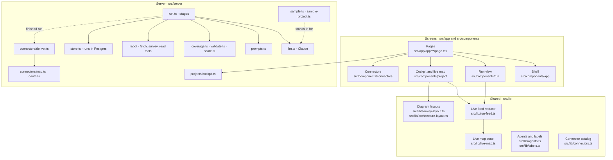
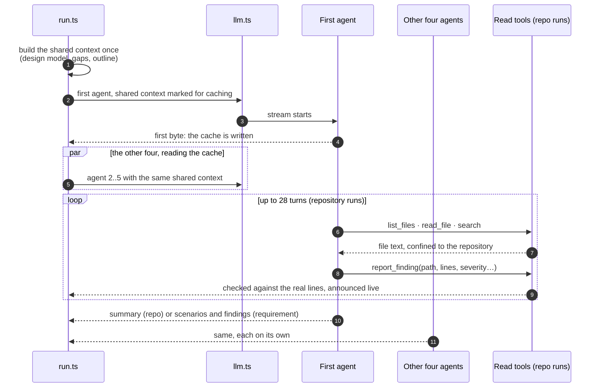
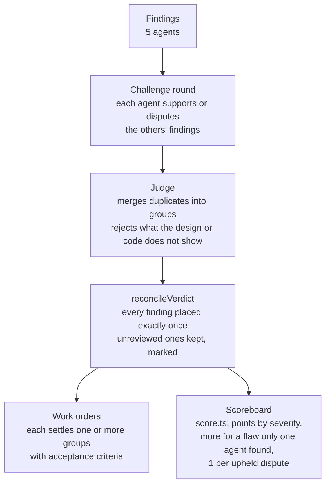
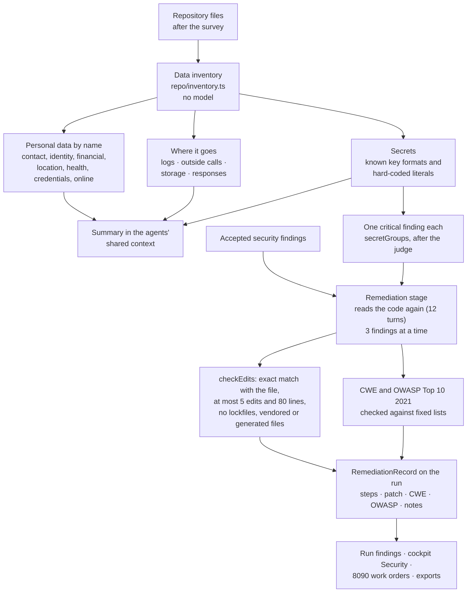
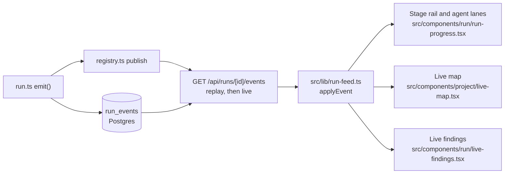
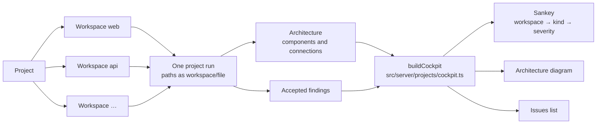
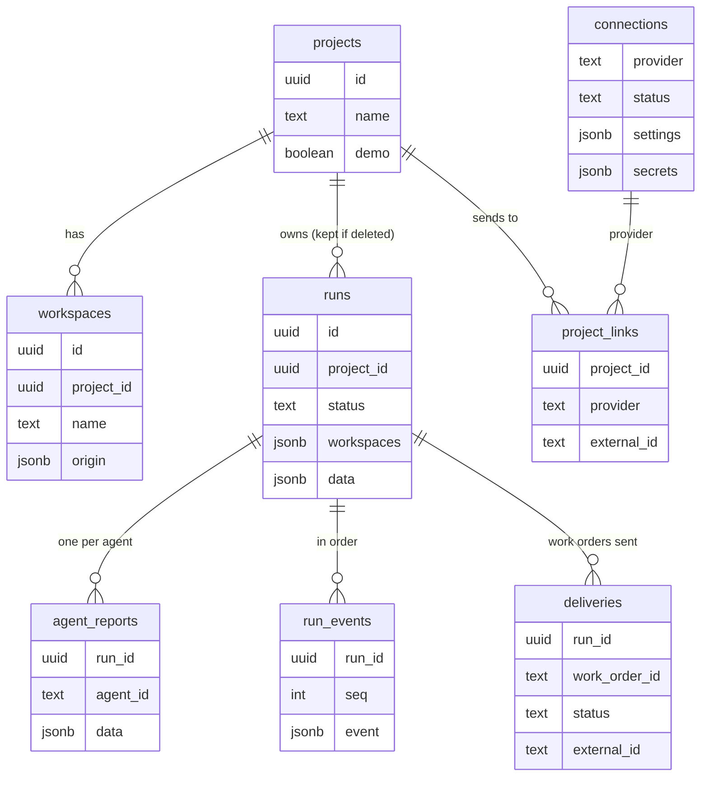
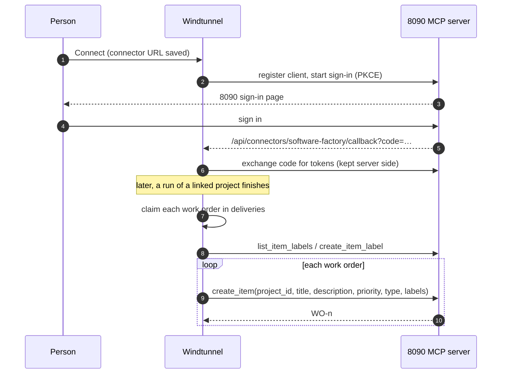

# Architecture

How Windtunnel is put together, from the whole system down to the agents.
Every diagram names the files that hold what it shows. The in-app view of
this page is under the book icon in the top bar (`/app/docs`).

**Keep this file current.** A change that adds, removes or renames a stage,
an agent, a table, an API route group, a connector or a top-level module
updates the matching section here in the same commit. `pnpm test` checks
that every file path, stage, agent and table named below still exists.

## 1. The system

One Next.js server holds the site, the product app, the API and the engine.
A run is not a separate service: it runs inside the server process and
outlives the request that started it.

| Part                  | Where                              | What it does                                       |
| --------------------- | ---------------------------------- | -------------------------------------------------- |
| Site                  | `src/app/(site)/page.tsx`          | The home page                                      |
| Product app           | `src/app/app/layout.tsx`           | Projects, cockpit, runs, settings                  |
| API                   | `src/app/api/`                     | `runs`, `projects`, `connectors`, `demo`, `health` |
| Engine                | `src/server/engine/run.ts`         | The stages of a run                                |
| One door to the model | `src/server/engine/llm.ts`         | Every Claude API call                              |
| Run registry          | `src/server/engine/registry.ts`    | Starts runs, streams their events                  |
| Database              | `src/server/db/schema.ts`          | The tables; migrations in `drizzle/`               |
| Docker                | `docker-compose.yml`, `Dockerfile` | The app and Postgres, locally                      |

## 2. The code, module by module

Rules that hold across modules (from `CLAUDE.md`):

- Only `src/server/engine/llm.ts` talks to the Claude API.
- Only `src/server/connectors/mcp.ts` talks to an MCP server.
- Nothing from a repository is ever installed, built or run.
- A model's claims are checked by code before they are kept.

## 3. A run, stage by stage

```mermaid
flowchart LR
  start(["Run started<br/>registry.ts startRun"]) --> survey
  survey["survey<br/>fetch, list files,<br/>data inventory<br/>repository runs only"] --> model
  model["model<br/>Opus 5.5<br/>design model, then<br/>architecture (2nd call)"] --> coverage
  coverage["coverage<br/>no model call<br/>gaps code can see"] --> agents
  agents["agents<br/>Sonnet 5.5 × 5<br/>in parallel"] --> challenge
  challenge["challenge<br/>Sonnet 5.5 × 5<br/>review each other"] --> judge
  judge["judge<br/>Opus 5.5<br/>merge, reject, rank<br/>+ secrets found by code"] --> remediation
  remediation["remediation<br/>Opus 5.5<br/>fix, patch, CWE, OWASP<br/>security findings only"] --> work_orders
  work_orders["work_orders<br/>Opus 5.5<br/>with acceptance criteria"] --> done
  done(["Run completed"]) -. "project linked" .-> deliver["Send work orders<br/>connectors/deliver.ts"]
```

| Stage       | Code                                                                                                         | Model      | Checked by                                                                                                               |
| ----------- | ------------------------------------------------------------------------------------------------------------ | ---------- | ------------------------------------------------------------------------------------------------------------------------ |
| survey      | `src/server/engine/repo/fetch.ts`, `src/server/engine/repo/survey.ts`, `src/server/engine/repo/inventory.ts` | none       | file and size limits                                                                                                     |
| model       | `src/server/engine/run.ts` with `MODEL_SYSTEM` or `REPO_MODEL_SYSTEM` in `src/server/engine/prompts.ts`      | Opus 5.5   | `normalizeModel` in `src/server/engine/coverage.ts`, `normalizeArchitecture` in `src/server/engine/architecture.ts`      |
| coverage    | `findCoverage` in `src/server/engine/coverage.ts`                                                            | none       | it is code                                                                                                               |
| agents      | `src/server/engine/run.ts`, briefs in `src/lib/agents.ts`                                                    | Sonnet 5.5 | `checkAgentReport` in `src/server/engine/validate.ts`, or `report_finding` in `src/server/engine/repo/agent-tools.ts`    |
| challenge   | `CHALLENGE_SYSTEM` in `src/server/engine/prompts.ts`                                                         | Sonnet 5.5 | `checkChallenges` in `src/server/engine/validate.ts`                                                                     |
| judge       | `JUDGE_SYSTEM` in `src/server/engine/prompts.ts`                                                             | Opus 5.5   | `reconcileVerdict` in `src/server/engine/validate.ts`                                                                    |
| remediation | `src/server/engine/remediation.ts`, `REMEDIATION_SYSTEM` in `src/server/engine/prompts.ts`                   | Opus 5.5   | `checkEdits` (every edit matches the real file), `resolveCwe` and `resolveOwasp` in `src/server/engine/security-refs.ts` |
| work_orders | `WORK_ORDER_SYSTEM` in `src/server/engine/prompts.ts`                                                        | Opus 5.5   | `checkWorkOrders` in `src/server/engine/validate.ts`                                                                     |

The stage list is `STAGES` in `src/server/engine/schema.ts`. Models are set
with `WINDTUNNEL_MODEL_REASONING` and `WINDTUNNEL_MODEL_AGENTS`
(`src/server/engine/config.ts`).

## 4. The agents

Five agents, each with one brief and its own expertise, compete to find
flaws. A judge credits each for the real flaws it found, more when no other
agent found them.

| Agent            | id                 | Looks for                                                    | Expertise                                         |
| ---------------- | ------------------ | ------------------------------------------------------------ | ------------------------------------------------- |
| Normal user      | `normal_user`      | Everyday journeys that the design leaves undefined           | `src/server/engine/expertise/normal-user.md`      |
| Adversarial user | `adversarial_user` | Abuse: permissions, tenancy, injection, secrets              | `src/server/engine/expertise/adversarial-user.md` |
| Chaos            | `chaos`            | Failure part-way: retries, timeouts, ordering, lost messages | `src/server/engine/expertise/chaos.md`            |
| Scale            | `scale`            | Growth: unbounded lists, hot paths, limits, cost             | `src/server/engine/expertise/scale.md`            |
| Product critic   | `product_critic`   | What the product must decide but has not                     | `src/server/engine/expertise/product-critic.md`   |

The briefs are `AGENTS` in `src/lib/agents.ts`; the expertise notes are
loaded by `src/server/engine/expertise.ts`.

### How they run

Why the first agent starts alone: the five share one long context. Sending
it once and letting it be cached before the others start makes the other
four read it at a fraction of the price (`release` in
`src/server/engine/run.ts`).

### Two kinds of run

|               | Requirement run                                            | Repository or project run                                                                  |
| ------------- | ---------------------------------------------------------- | ------------------------------------------------------------------------------------------ |
| Input         | A written requirement and files                            | One or more repositories (workspaces)                                                      |
| Agent call    | One structured answer: scenarios and findings (`llm.call`) | A tool loop (`llm.agent`): read the code, file findings one by one                         |
| Tools         | none                                                       | `src/server/engine/repo/agent-tools.ts`, reading through `src/server/engine/repo/tools.ts` |
| Finding check | Every reference must exist in the design model             | Every cited file and line must exist in the code                                           |
| Live findings | At the end                                                 | The moment each is filed                                                                   |

### From findings to work orders

### The stand-in model

`ScriptedLlm` in `src/server/engine/sample.ts` takes the place of `llm.ts`
for tests, sample mode and sample projects. It makes the same tool calls a
model would, so every check still runs. The Storefront script is
`src/server/engine/sample-project.ts`, keyed by repository, against the
files in `samples/storefront/`.

## 5. Security: remediation, personal data and secrets

Three parts work together. None of them runs code from the repository.

| Part            | Where                                                                                                             | Holds to                                                                                                                       |
| --------------- | ----------------------------------------------------------------------------------------------------------------- | ------------------------------------------------------------------------------------------------------------------------------ |
| Data inventory  | `src/server/engine/repo/inventory.ts`                                                                             | Found by name, so it may include false positives; says so on screen                                                            |
| Secret findings | `secretGroups` in `src/server/engine/remediation.ts`                                                              | A secret's value is never saved: only its kind, file, line and a masked line. `scrubDeep` masks it in everything the run saves |
| Remediation     | `src/server/engine/remediation.ts`                                                                                | Never fails the run; an edit that does not match the file is dropped with the reason; a patch is never applied                 |
| References      | `src/server/engine/security-refs.ts`                                                                              | An unknown CWE falls back to its OWASP category's CWE, marked as such                                                          |
| Diff            | `src/lib/patch.ts`                                                                                                | Three lines of context; `git apply --check` accepts it                                                                         |
| Screens         | `src/components/run/remediation.tsx`, `src/components/project/security.tsx`, `src/components/project/privacy.tsx` | Colour only in the diff                                                                                                        |

Not covered yet: known-vulnerable dependencies (needs an advisory database).

## 6. Live updates

Every event is saved before it is sent, so a page opened half-way replays
what it missed. The event types are `RunEvent` in
`src/server/engine/schema.ts`; the stream is
`src/app/api/runs/[id]/events/route.ts`.

## 7. Projects and the cockpit

Projects and workspaces: `src/server/projects/store.ts`. Older runs with no
project are gathered under "Demo project" by `src/server/projects/adopt.ts`.
Sample data: `src/server/projects/demo.ts`.

## 8. The data

Tables: `projects`, `workspaces`, `runs`, `agent_reports`, `run_events`,
`connections`, `project_links`, `deliveries`. The structured results of a
run are JSON in `runs.data`, shaped by `RunRecord` in
`src/server/engine/schema.ts`. Migrations are applied at start by
`src/server/db/ready.ts`.

## 9. Connectors

| Part                      | Where                                                                                                                                |
| ------------------------- | ------------------------------------------------------------------------------------------------------------------------------------ |
| MCP client                | `src/server/connectors/mcp.ts`                                                                                                       |
| Sign-in and token storage | `src/server/connectors/oauth.ts`, `src/server/connectors/store.ts`                                                                   |
| 8090 mapping              | `src/server/connectors/software-factory.ts`                                                                                          |
| Sending, once each        | `src/server/connectors/deliver.ts`                                                                                                   |
| Screens                   | `src/components/connectors/connectors.tsx`, `src/components/connectors/project-link.tsx`, `src/components/connectors/deliveries.tsx` |
| Catalog                   | `src/lib/connectors.ts`, logos in `src/lib/connector-icons.ts`                                                                       |
